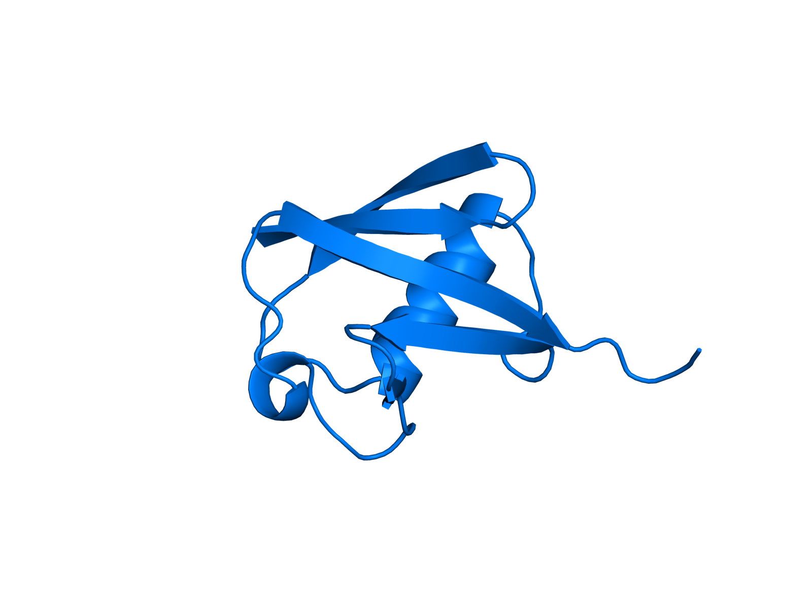
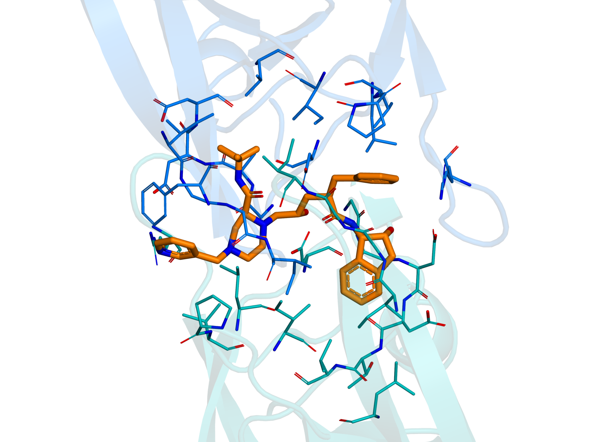
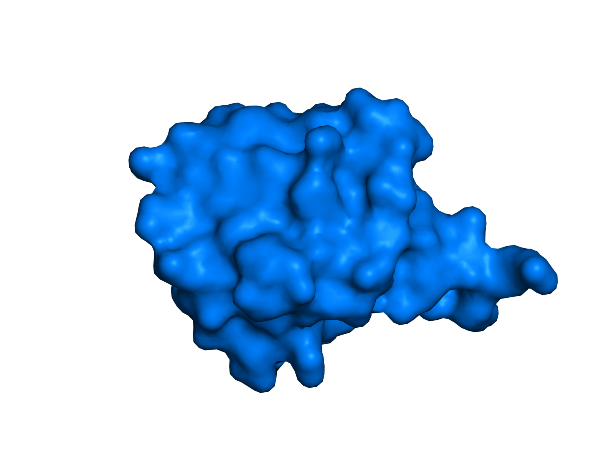
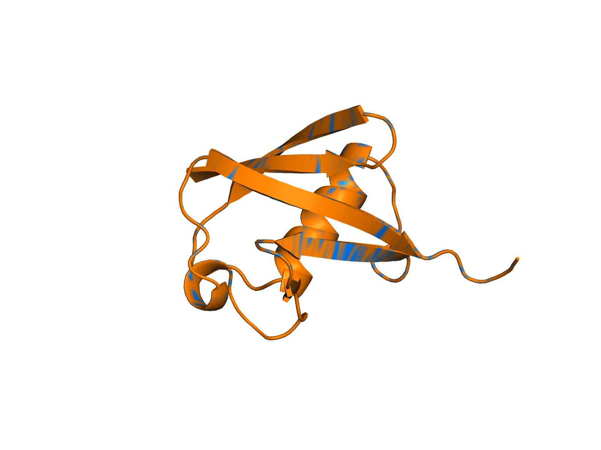

# MolScene

[](https://github.com/c-chunhao/molscene/actions/workflows/ci.yml)

**Reproducible molecular figures and structural checks, powered by your PyMOL.**

[简体中文](README.zh-CN.md) · [Examples and data provenance](examples/README.md) · [Validation](docs/TESTING.md) · [Interface notes](docs/INTERNALS.md)

MolScene turns local PDB and mmCIF files into a ray-rendered figure, an editable PyMOL session, a replay script, and a JSON record of inputs and results. Use it to prepare consistent structure panels, examine a ligand neighborhood, measure a specified atom pair, or inspect a protein superposition while keeping the choices behind the figure reviewable.

| Ubiquitin overview | HIV protease ligand pocket |
| --- | --- |
|  |  |

| Molecular surface | PDB/mmCIF alignment check |
| --- | --- |
|  |  |

## Quick start

Use Python 3.10 or newer **in an environment that can import `pymol2`**. MolScene does not bundle or install PyMOL. Run these commands from the repository root; `python` below means the interpreter belonging to your PyMOL environment.

```sh
git clone https://github.com/c-chunhao/molscene.git
cd molscene
python -m molscene doctor
python examples/download_examples.py
python -m molscene render examples/data/1ubq.pdb --output results/overview
```

For example, if your existing Windows installation provides `D:/soft/pymol/python.exe`, PowerShell commands take this form (substitute your own installation path):

```powershell
& "D:/soft/pymol/python.exe" -m molscene doctor
& "D:/soft/pymol/python.exe" -m molscene render examples/data/1ubq.pdb --output results/overview
```

The checkout is directly runnable. To use it from another directory, optionally install MolScene into that same environment:

```sh
python -m pip install -e .
```

If `doctor` cannot import PyMOL, switch to your existing PyMOL interpreter or create an independent environment with the [open-source PyMOL distribution](https://github.com/schrodinger/pymol-open-source). One conda-forge setup is:

```sh
conda create -n molscene -c conda-forge python=3.10 pymol-open-source pillow pip
conda activate molscene
python -m pip install -e .
python -m molscene doctor
```

Pillow is used for image validation in the test suite; the core CLI uses Python's standard library and the separately installed PyMOL backend. See [tested environments and CI scope](docs/TESTING.md) before interpreting a backend as verified.

## Workflows

```sh
# Protein cartoon (default), with chains colored and organic ligands as sticks
python -m molscene render examples/data/1ubq.cif --output results/cartoon --width 1600 --height 1200 --dpi 300

# Protein surface
python -m molscene render examples/data/1ubq.pdb --style surface --output results/surface

# Whole protein residues with atoms within 5 Å of the ligand
python -m molscene render examples/data/1hsg.pdb --style pocket --ligand "resn MK1" --radius 5 --output results/pocket

# Geometric distance between exactly one atom at each endpoint
python -m molscene measure examples/data/1ubq.pdb --selection-a "chain A and resi 1 and name CA" --selection-b "chain A and resi 2 and name CA" --output results/distance

# Coordinate-format consistency check using the same structure
python -m molscene align examples/data/1ubq.pdb examples/data/1ubq.cif --selection "polymer.protein and name CA" --output results/alignment

# Offline check using generated test structures
python -m molscene selftest --output results/selftest
```

Use `python -m molscene COMMAND --help` for options. Quote selections so the shell passes each expression as one argument. Selections use [PyMOL syntax](https://pymol.org/pymol-command-ref.html), scoped to the relevant loaded object by MolScene.

Rendering, measurement, and alignment produce:

| File | Purpose |
| --- | --- |
| `scene.png` | Figure at the requested pixel dimensions |
| `scene.pse` | Editable PyMOL session |
| `scene.pml` | Standalone replay script, with accompanying input copies |
| `report.json` | UTC timestamp, tool/backend versions, input SHA-256 hashes, parameters, structure counts, analysis results, and artifact names |

Keep the output directory together when sharing a replay. Start a fresh PyMOL session and run `@scene.pml` from that directory, or open `scene.pse` for interactive editing. Reports identify inputs by filename and hash rather than publishing your local absolute paths.

Output directories must be empty. To deliberately rerun a command, add `--overwrite`; this replaces MolScene's fixed outputs without deleting the directory. Invalid files, empty selections, ambiguous measurement endpoints, nonfinite parameters, and unsafe input/output collisions fail with a nonzero exit status.

## Interpreting results

- A pocket is a **geometric neighborhood**. MolScene expands protein atoms within the radius to whole residues. For the pinned 1HSG example, `resn MK1` selects 45 atoms; a 5 Å neighborhood contains 115 protein atoms and expands to 236 atoms in 33 protein residues. This does not classify hydrogen bonds or estimate binding affinity.
- Measurement requires exactly one atom per selection and returns a distance in Å. Check chain, residue, atom name, and alternate conformations before comparing structures.
- Alignment uses PyMOL `cmd.align`, including sequence matching and outlier refinement. The JSON records its fit statistics and parameters. This is intended for related proteins; its reported RMSD is not a universal similarity score. The figure above aligns the same 1UBQ coordinates in two formats as a reproducibility check.
- A molecular surface is a visualization, not an electrostatic potential calculation. Figure quality does not establish model quality.

## Evidence, scope, and contribution

On 2026-10-15, MolScene's full **36-test suite** and **9-check CLI selftest** passed on both locally tested PyMOL backends (implementation revision `684bce7`):

| Local Windows environment | Tool tests | CLI selftest |
| --- | --- | --- |
| Python 3.10.18 + installed Incentive PyMOL 3.1.6.1 | 36 passed, 0 skipped | 9/9 passed |
| Python 3.10.18 + community open-source wheel 3.2.0a0, native 3.2.0a | 36 passed, 0 skipped | 9/9 passed |
| Plain Python 3.14.3, without PyMOL | 18 passed, 18 skipped (36 discovered) | Requires PyMOL |

The community wheel is a prerelease build. The Linux conda-forge PyMOL 3.1.0 integration job has also [passed 35 scientific tests and 9 self-test checks](https://github.com/c-chunhao/molscene/actions/runs/38674100313/job/116223640261). The current workflow badge reports the complete CI matrix. [Testing documentation](docs/TESTING.md) records commands, coverage, timings, and manual gallery checks.

The public gallery uses the independent community open-source wheel (package **3.2.0a0**, native **3.2.0a**). Larger exports from the local installed bundle displayed an evaluation overlay; the [environment and output notes](docs/TESTING.md#tested-environments-and-output-limits) distinguish API test results from licensing and figure-quality checks.

Rendering is protein-centric and requires protein atoms; water-only and DNA/RNA-only structures are currently unsupported by `render`. `measure` can use general atom selections within its loaded object and still requires exactly one atom at each endpoint. The CLI works on local structures without network access. Only the optional example downloader connects to RCSB PDB, for three fixed, checksum-verified public files. There is no GUI, remote fetching in the core CLI, docking, trajectory processing, or prediction workflow in this release.

See [CONTRIBUTING.md](CONTRIBUTING.md) for development and bug reports. MolScene's original code is [MIT licensed](LICENSE). PyMOL is a separate dependency subject to its own distribution's license; see the [upstream open-source license](https://github.com/schrodinger/pymol-open-source/blob/master/LICENSE). MolScene is an independent project and is not affiliated with or endorsed by Schrödinger or the PyMOL project. The public [interface analysis](docs/INTERNALS.md) documents normal API boundaries and measured behavior.

Example structures are credited to their depositors and primary publications in the [example guide](examples/README.md). Cite the original structure papers when using their coordinates in research.
