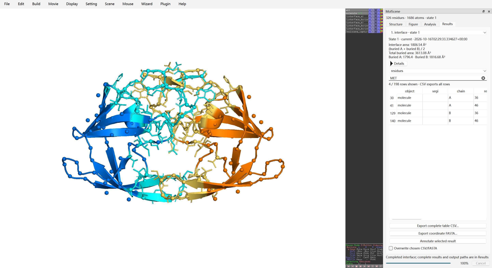
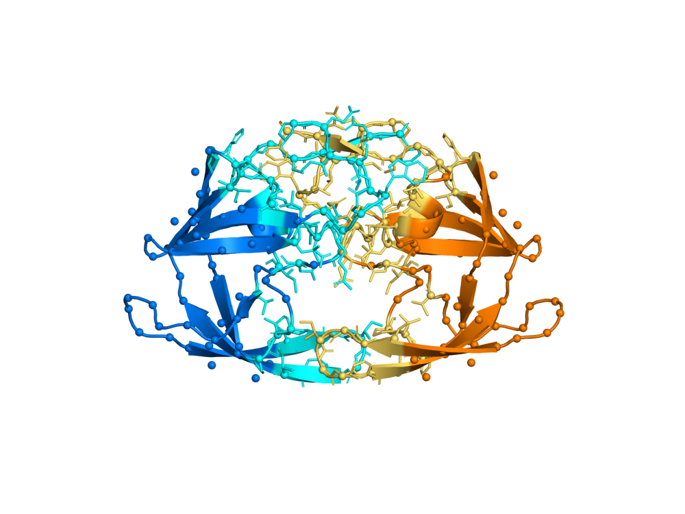
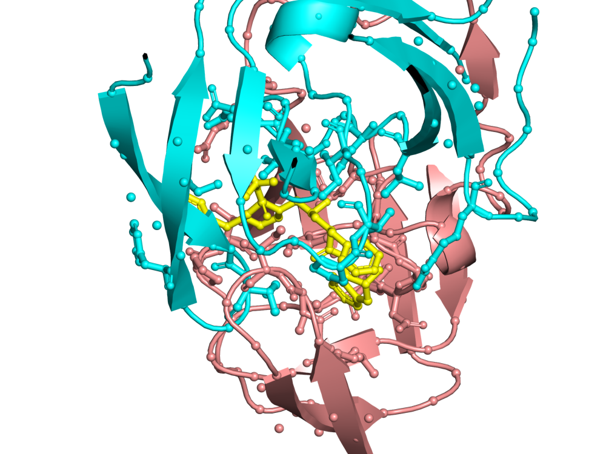

# MolScene 0.3

**在 PyMOL 原生桌面中完成结构分析与可复现制图。**

[English](README.md) · [桌面操作指南](docs/GUI.md) · [实例与数据来源](examples/README.md) · [测试记录](docs/TESTING.md) · [科学定义与内部接口](docs/INTERNALS.md)

MolScene 在上游 PyMOL Qt 主窗口中加入工作台 dock，保留原生的旋转、缩放、原子拾取、对象菜单和命令界面。工作台提供观测残基导航、精确选择传递、现场预设、清理副本、场景书签编辑及结果搜索；面板与离线 CLI 共用几何、几何接触、溶剂可及表面积（SASA）、伙伴界面面积和结构概况算法，输出图像、完整表格、可编辑会话、回放脚本与来源报告。分子引擎及原生界面由 PyMOL 提供。



v0.3 真实桌面截图：1HSG 蛋白 A/B 链，state 1，半总埋藏界面面积 1806.54 Ų。
结果页从完整 198 行中筛出 4 行 MET；CSV 仍导出全部行。[操作指南](docs/GUI.md)。

| v0.3 蛋白伙伴界面 | v0.3 现场 pocket 预设 |
| --- | --- |
|  |  |

1HSG 的两个蛋白伙伴各保留 757 原子，按半总埋藏面积约定得到 1806.538812 Ų。
现场 5 Å 几何口袋包含 33 残基位点、236 蛋白原子。
[v0.3 完整产物与科学定义](examples/README.md#v03-interface-and-live-workflows)。

## 安装和启动

核心 CLI 需要 Python 3.10 及以上，实际计算还需要独立安装的 PyMOL。固定 GUI 额外依赖要求 Python **3.10–3.13**：PySide6-Essentials 6.8.1 要求 Python 低于 3.14，本地桌面验证版本为 3.10.18。建议先使用 Python 3.10 后端环境。MolScene 不捆绑 PyMOL。使用能够 `import pymol2` 的解释器：

```sh
git clone https://github.com/c-chunhao/molscene.git
cd molscene
python -m pip install ".[gui,test]"
python -m molscene doctor
python -m molscene gui examples/data/1ubq.pdb --workspace workspace
```

`gui` 额外依赖固定为 `PySide6-Essentials==6.8.1`；工作台通过 `pymol.Qt` 使用兼容 binding，同一进程不能混用 Qt binding。`test` 安装用于验证图像的 Pillow。普通导入、版本和帮助不需要 PyMOL 或 Qt；实际计算需要 PyMOL，桌面还需要原生 Qt 资源和有效 OpenGL 显示环境。

也可以独立创建 conda-forge 环境：

```sh
conda create -n molscene -c conda-forge python=3.10 pymol-open-source pyqt pillow pip
conda activate molscene
python -m pip install .
python -m molscene gui examples/data/1ubq.pdb --workspace workspace
```

conda 配方会自行解析 Qt 版本，不代表未来解析出的所有组合已经验证。本地已测试桌面组合为 Windows、Python 3.10.18、社区 PyMOL 包 3.2.0a0 / native 3.2.0a、PySide6/Qt 6.8.1、NumPy 2.2.6。该 PyMOL wheel 是预发布版本。[测试记录](docs/TESTING.md) 区分真实桌面、仅后端和无依赖测试，并记录实际版本。

## 命令行工作流

以下命令从仓库根目录运行。安装后可从其它目录使用自己的本地文件。selection 是 PyMOL 表达式，需要整体加引号。

```sh
python -m molscene render examples/data/1ubq.pdb --output results/overview
python -m molscene render examples/data/1ubq.pdb --representation surface --coloring bfactor --state 1 --background transparent --output results/surface
python -m molscene render examples/data/1hsg.pdb --style pocket --ligand "resn MK1" --radius 5 --output results/pocket
python -m molscene measure examples/data/1ubq.pdb --selection-a "resi 1 and name CA" --selection-b "resi 2 and name CA" --state 1 --output results/distance
python -m molscene angle examples/data/1ubq.pdb --selection-a "resi 1 and name CA" --selection-b "resi 2 and name CA" --selection-c "resi 3 and name CA" --state 1 --output results/angle
python -m molscene dihedral examples/data/1ubq.pdb --selection-a "resi 1 and name CA" --selection-b "resi 2 and name CA" --selection-c "resi 3 and name CA" --selection-d "resi 4 and name CA" --state 1 --output results/dihedral
python -m molscene contacts examples/data/1hsg.pdb --selection-a "resn MK1" --selection-b "polymer.protein" --cutoff 4 --state 1 --output results/contacts
python -m molscene sasa examples/data/1ubq.pdb --selection "polymer.protein" --context "not solvent and not hydro" --altloc primary --state 1 --output results/sasa
python -m molscene interface examples/data/1hsg.pdb --selection-a "chain A and polymer.protein" --selection-b "chain B and polymer.protein" --altloc primary --state 1 --output results/interface
python -m molscene inspect examples/data/1ubq.cif --state 1 --output results/inspect
python -m molscene align examples/data/1ubq.pdb examples/data/1ubq.cif --method align --mobile-state 1 --target-state 1 --output results/alignment
python -m molscene batch examples/data --state 1 --width 800 --height 600 --output results/batch
python -m molscene selftest --output results/selftest
```

显示方式包括 cartoon、ribbon、sticks、lines、spheres、surface、mesh、dots、nonbonded；着色包括 chain、element、single、rainbow、bfactor。原有 cartoon/surface/pocket 预设以蛋白为中心；显式表示方式可用于适合的非蛋白选择，cartoon/ribbon 需要合适的聚合物。B-factor 着色记录实际范围，计算保留原 B-factor。完整选项见 `python -m molscene COMMAND --help`。

## 科学口径与结果

所有操作固定正整数 `state`，CLI 默认 1；缺少该态的坐标会报错，不借用其它帧。叠合分别指定 mobile/target state。多状态文件并不等于经过验证的轨迹分析。

距离端点各需一个原子；角度 A–B–C 以 B 为顶点；二面角遵循 PyMOL 的有符号约定。距离单位 Å，角度单位度，退化几何明确失败。

接触表列出 cutoff 内不重复的无向重原子对，默认 4 Å，排除自身配对，跨对象保留身份。这是几何接近，不能直接解释为氢键或结合亲和力。超过 100000 对会失败，不截断；图中至多画最短 200 对，成功 CSV 保留全部结果。

SASA 使用 1.4 Å 探针、dot density 3、溶剂可及点。默认 context 为目标所在对象中的非溶剂重原子，`primary` altloc 保留空白+A；target 必须属于过滤后的 context。将完整 context 合并计算后汇总 target 面积，保留跨残基、跨对象遮挡，不能逐残基孤立计算再求和。`--altloc all` 纳入全部构象，会改变解释。坐标序列来自实际 guide atoms，保留残基映射，未知字符记为 X，不补缺失残基，也不声称恢复完整 SEQRES。

制图、测量、叠合生成 `scene.png`、`scene.pse`、`scene.pml`、`report.json` 和输入副本。接触另有 `contacts.csv`，SASA 另有 `sasa.csv`；inspect 不强制渲染，生成 `chains.csv` 和 `sequence.fasta`。批处理按稳定顺序非递归读取 PDB/CIF/mmCIF，输出 `batch.json`、`batch.csv` 及编号子目录；失败返回非零，取消保留完成项，不把待运行项记为成功。

报告使用 schema_version 2，保存输入哈希、参数、单位和相对产物路径，并保留旧 distance/RMSD 字段。非空目录需显式 `--overwrite`；危险链接、别名和输入输出碰撞会被拒绝；失败不破坏旧的有效输出。

CLI 坐标工作流的 PML 使用输入副本和记录的 API 操作，可脱离 MolScene 回放。GUI 自由编辑的现场通过 PSE 保存，其 PML 会加载随附 PSE，因此必须完整保留输出目录。分析记录 state、时间与坐标语义指纹，场景变化后标注 stale。[桌面指南](docs/GUI.md) 说明面板流程。

## 来源、范围和许可

界面分析要求两组经非溶剂重原子及 altloc 过滤后互不重叠的伙伴。计算 context 严格等于 A∪B，同一对象中的其他原子也不参与。分别报告 A 单独暴露面积减去 A 在 A+B 中面积的差值、B 的对应差值、两者之和 **total buried area**，以及其一半 **interface area**，单位 Ų。保留有符号数值差与完整伙伴/残基 `interface.csv`，不将几何面积解释为亲和力或自由能。

残基浏览器只显示实际坐标中的位点，保留对象、segment、chain 和残基字符串标识，不补齐缺失序列。现场 overview/surface/pocket 预设作用于明确选择；pocket 为所选 context 内距指定配体原子不超过半径的聚合物残基。清理副本把所选 state 的过滤结果保存到新对象的 state 1，报告移除数量及原始身份，不添加氢或分配质子化状态。结果搜索/排序只改变预览，CSV 保留完整原始表。[v0.3 复现指南](examples/README.md#v03-interface-and-live-workflows) 单独保存新实例，历史 v0.2 图库仍可使用。

MolScene 自有代码采用 [MIT](LICENSE)。PyMOL、Qt 及其原生资源遵守各自发行版的许可；上游 viewport、菜单、命令控制台和分子引擎不是从商业安装复制或重新实现的。项目独立开发，与 Schrödinger / PyMOL 无隶属或背书关系。详见 [上游开源许可](https://github.com/schrodinger/pymol-open-source/blob/master/LICENSE) 和 [接口分析](docs/INTERNALS.md)。

本轮验证常用表示与着色、对象/场景管理、指定态几何、几何接触、SASA、坐标序列、叠合和批量制图。经过验证的氢键化学判定、轨迹统计、独立电影时间轴、密度图专用工作流、静电势、自动生物学组装及商业专属组件仍是后续范围，不宣称全面商业等价。原生 PyMOL 可能提供其它命令，其行为和许可由上游决定。

公开示例由独立开源运行时正常生成，未移除或修改评估水印。结构数据保留 [原始归属](examples/README.md)。核心工具离线运行，仅单独调用的固定来源、校验和验证下载器联网。参阅 [验证记录](docs/TESTING.md) 与 [贡献指南](CONTRIBUTING.md)。
