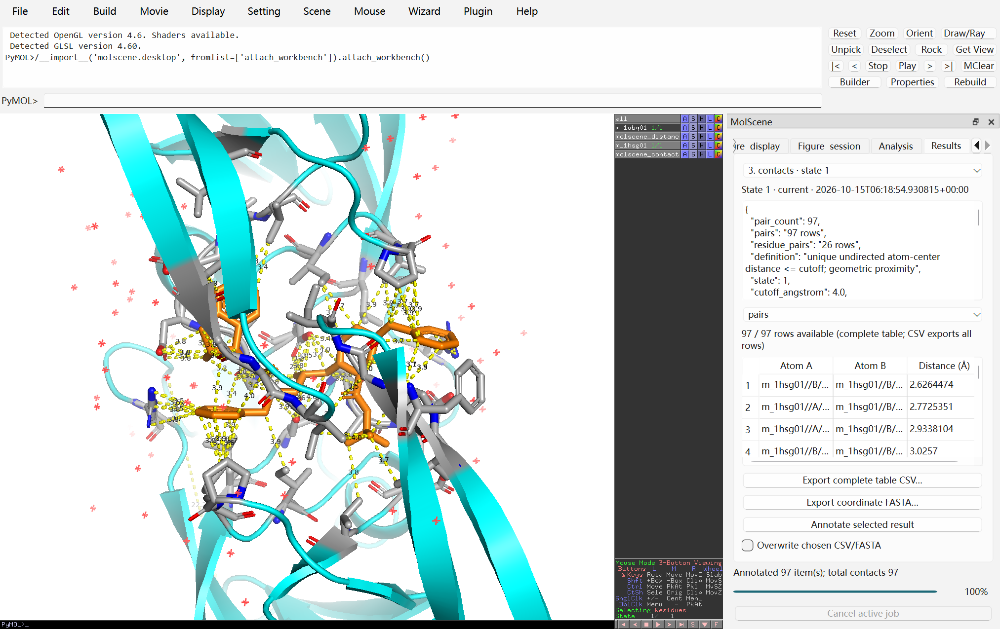
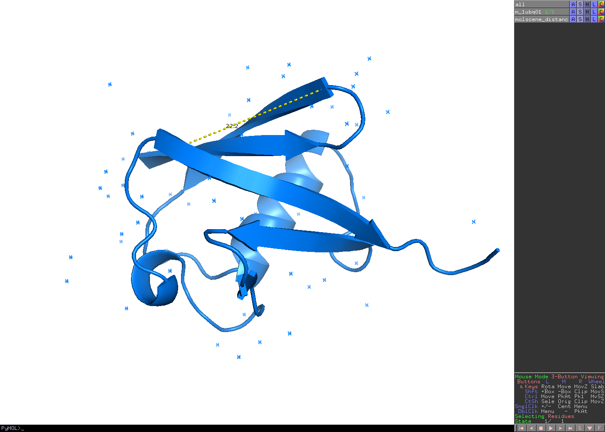

# MolScene desktop guide / 桌面工作台指南

## v0.5 daily controls

The five pages keep their order: **Structure, Figure, Analysis, Results,
Advanced**. At 360–540 logical pixels the full-name page selector replaces the
tab bar; widening the dock restores tabs. Both routes stay synchronized. During
an asynchronous job the mutation pages are locked; Results and Cancel remain
available. Cancel requests cooperative cleanup; normal window close waits for
owned work to finish cancelling.

In **Analysis**, set Selection / target (A), Partner B and an explicit positive state, then
choose **Calculate polar candidates**. Defaults are cutoff 3.5 Å, native angle
45°, and primary blank+A altloc. Distance is strictly **less than** cutoff;
angle is a permissive native endpoint orientation tolerance, not a measured
D–H–A angle. Results retain complete directed donor→acceptor rows and CSV;
annotation draws at most 200. At most 100,000 preflight candidates and separately
100,000 directed outputs are allowed. A topology, typing, charge or coordinate
change makes the result stale; camera motion alone does not. Recalculate stale
results before annotation. These candidates depend on native typing and existing
bonds/protonation; they are not confirmed hydrogen bonds or affinity estimates.

In **Figure**, use the Structure selection/state, choose a label recipe, then
**Preview** before **Apply recipe**. `atom`
prints the atom name; `residue` prints residue name plus full residue identifier
(e.g. `GLY12A`); `chain_residue` prints `A:GLY12A`, or `(blank):GLY12A` for a
blank chain. Each residue gets one selected anchor: CA, then P, then a heavy atom,
then any atom; within a class prefer blank, A, then the lowest native index.
Recipes never expand outside selected membership. `custom` explicitly evaluates
your native expression; its preview leaves the expression unevaluated. At most
500 labels apply. Size accepts native positive values 8..48 and is shared by
all labels in each target object at the requested state, including other labels
there. Text and color affect only target atom identities and are shared across
ordinary coordinate states. Clearing labels leaves their styles intact.

The **Figure** save controls export selected coordinates (`cif` default or `pdb`)
at one chosen positive state, or save the complete current captured PSE. Choose
a new output directory. Coordinate export writes `objects/0001.cif`, etc., one
file per original source object, plus `membership.csv`, report, manifest and
portable replay. Reload checks preserve core atom identity and world coordinates
within 0.001 Å; widths/identity that the native writer cannot preserve fail.
PDB has narrow ASCII fields; use cif for wider identifiers. Coordinates do not
preserve all styling, maps, states, charges, radii or complete bond topology.
The full PSE preserves the captured session bytes, including states, maps,
scenes and labels. Results calls these **Saved snapshot**; later live changes do
not turn a save into current scientific analysis. Open the saved PSE explicitly
to restore it. These saves require no PNG, ray tracer or OpenGL operation.

Advanced map/PQR/DX/tools/timeline path rows have Browse controls. Cancel leaves
the field unchanged. Output browse selects a parent plus an uncreated leaf;
selecting an existing directory does not authorize replacement. Mode changes
hide the whole unused row. Tool summaries retain availability/version/actual
architecture; full paths, argv and errors are in Details/tooltips. Density
summaries retain shape, origin, units and raw thresholds; matrices/hashes are in
Details. Full-table CSV export is independent of preview search/sort.

示例与离线命令见 [Examples](../examples/README.md#v05-daily-workflows)。五个主页面及其顺序不变；
窄面板用完整页名选择器，任务期间仍可进入 Results 并取消。坐标与会话结果显示“Saved
snapshot”，不会把冻结快照误作后来现场状态的科学验证。

Start the native window with an explicit workspace:

Use a Python 3.10–3.13 environment for the pinned PySide6-Essentials 6.8.1 extra; its upstream Python constraint is `<3.14`. The tested/recommended starting combination is Python 3.10.18 with the backend recorded in [TESTING.md](TESTING.md). MolScene's core CLI remains Python 3.10+.

固定 GUI 依赖适用 Python 3.10–3.13，本地验证并推荐从 Python 3.10 后端环境开始；核心 CLI 的 Python 3.10+ 要求不变。

```sh
python -m molscene gui examples/data/1ubq.pdb --workspace workspace
```

The central viewport, mouse controls, menus, command console and molecular engine are upstream PyMOL. MolScene attaches one dock; closing it does not destroy your molecular scene, and the MolScene menu restores the same dock. It does not install a plugin into the PyMOL program directory or replace saved startup preferences. A working native OpenGL display is required; an offscreen widget alone does not establish desktop compatibility.

启动后，中央三维视口及鼠标交互来自上游 PyMOL，MolScene 只添加工作台 dock。关闭 dock 后可从菜单重新打开，同一窗口仅保留一个 dock。工作空间保存快照及任务结果；使用适合自己的可写目录。


The v0.3 capture is an unedited native window from 2026-10-16: full 1HSG
protein A/B context, state 1, interface area 1806.538812 Ų and total buried
area 3613.077624 Ų. The MET search shows 4 of the complete 198 residue rows.
The native command/log dock and selection indicators were hidden using native
controls before direct capture; the molecular data and result were unchanged.
The real interface worker completed and the window closed normally. This source
capture is separate from final source-suite and installed-wheel acceptance.

以下旧截图及点击记录保留为 v0.2 历史证据；上方为本轮真实原生截图。





These are unmodified native captures from the open-source Windows runtime described in [TESTING.md](TESTING.md). The [machine-readable click trace](screenshots/native-workbench.json) records real display/color/geometry/inspection, CSV/FASTA, contacts, SASA, current-view export and batch controls. The run found 97 MK1/protein contact pairs and ligand SASA 97.795410 Ų in the protein-containing context. Closing during batch deferred native shutdown until cooperative cancellation finished: two items completed and three remained pending. This is separate from the CLI's 1UBQ protein-SASA example.

截图由真实原生界面直接保存，未合成或修改。点击记录包含制图、数值、表格导出、快照任务及关闭窗口时取消批处理的真实路径；不同靶选择/context 的 SASA 数值不可直接当作同一指标比较。

## Structures and display / 结构与显示

Load local PDB/mmCIF structures, or open a PSE through the separate session action. Opening a PSE restores its objects, representations, view and state without applying fresh-structure defaults. Use Refresh after edits in PyMOL's native controls. Select the intended objects before Show/Hide, Orient, Rename or Delete; destructive object actions require an explicit object choice.

输入 selection 后检查匹配的对象和原子数。可捕获当前 `sele` 或原生拾取产生的 `pk1`–`pk4`；几何端点各需一个原子。state 必须是正整数；不存在该态坐标的对象不能借用其它帧。

Apply representation and coloring to the intended selection. Available modes include cartoon/ribbon, sticks/lines, spheres, surface/mesh/dots and nonbonded; coloring supports chain, element, single color, rainbow and B-factor. Cartoon/ribbon need a suitable polymer. Preserve the backbone interpretation: a trace through every atom is not a valid protein cartoon. Scene bookmarks save and restore native scene views and travel with PSE sessions.

## Residue navigation and live tools / 残基导航与现场操作

Keep the intended coordinate state and context selected. The residue browser
shows observed coordinate sites, with object/chain filters, text search and a
polymer-only default. Disable that filter to locate ligands, ions or solvent.
Refresh after native edits; unchanged periodic object refresh does not rescan
all atoms or reset the browser selection. Residue labels retain segment,
insertion code and blank-chain distinctions; this is not full SEQRES.

Use selected objects, selected browser residues, current native `sele` or a
named selection as the active selection. Check its atom/residue/state summary,
then send it to analysis target/A or B. Browser handoff binds the original atom
identities and rejects stale/deleted membership. Save a reusable name explicitly;
collisions/reserved names fail. Delete only a chosen existing user selection.

选择观测残基后可传到分析 A/B；发送前核对对象、原子数、残基数和 state。
配体在默认聚合物筛选之外；先显示全部残基类型，再选择配体并使用配体传递按钮。
此操作只设置 pocket 的 ligand，不会把完整 context 替换成配体本身。

Focus centers/zooms the active selection with a nonnegative buffer and optional
orientation. Hide solvent/hydrogen controls hide representations without
deleting atoms. Live overview, surface and pocket presets apply to the active
context, with an explicit camera-frame option. Pocket needs a nonempty ligand
subset, positive radius and nearby selected polymer atoms. Its whole-residue
neighborhood is geometric, not a chemical interaction assignment. Advanced
representation/color/background controls remain available in their groups.

Clean copy creates a new explicitly named object from the chosen source state,
placing retained atoms in the new object's state 1. Choose solvent removal,
optional H/D/T removal and primary blank+A versus all alternates. The result
reports before/retained/removal counts and original retained identities. Source
atoms, bonds and coordinates remain intact. This does not add hydrogens,
repair missing atoms or assign a pH/protonation state. Scene bookmarks support
update, rename and double-click recall; save the PSE to retain them.

清理副本保留原结构，按所选 state 过滤并创建新对象的 state 1；不是自动质子化
或结构修复。场景更新/重命名保留其他书签，并随 PSE 保存。

## Analysis and results / 分析与结果

For a distance, capture A/B; for an angle capture A/B/C (B is the vertex); for a signed dihedral capture A/B/C/D. Inspect the returned identities and units. Empty, ambiguous or degenerate endpoints produce an error that leaves the window usable.

In **Analysis**, choose **Mobile object** and **Target object** for a live alignment. **Analysis state** supplies the mobile state; **Target state** fixes the reference state. Choose `align` or `super`, an **Alignment selection**, **Alignment cutoff (Å)** and **Refinement cycles**, then **Align live mobile object**. The transformation is applied visibly to the mobile object. Inspect the algorithm, states, RMSD and matched-atom count in the result rather than treating RMSD as a universal similarity score.

叠合时分别检查移动对象、参考对象及两个 state。面板支持 `align` / `super`，执行后移动对象在真实场景中变换；保留算法、cutoff、cycles 及匹配统计。

接触与 SASA 从当前 state 的不可变 PSE 快照在独立进程计算。接触默认 cutoff 4 Å、仅重原子；它是几何距离，不是氢键或亲和力判定。SASA 默认 context 为目标所在对象中的非溶剂重原子、altloc 空白+A，探针半径 1.4 Å、dot density 3。target 必须属于过滤后的 context；完整 context 的遮挡参与计算。坐标序列来自观测 guide atoms，未知字符为 X，不补缺失残基。

Results record state, calculation time, snapshot byte identity and a semantic coordinate fingerprint. Changing coordinates, molecular content or state after capture can make a result stale. A camera change alone does not change the molecular fingerprint. Stale/unverified results remain evidence of their source snapshot; they must not be interpreted as current-scene analyses or receive current-scene annotations. Inspect complete CSV/FASTA outputs for tables; any bounded table preview is labelled with displayed/total rows.

For interface area, use analysis target as partner A and the partner field as B,
then run interface analysis. Partners must be disjoint after non-solvent heavy-
atom and altloc filtering; context is exactly their union. Read both partner
losses, their total buried area and the explicitly labelled half-total interface
area, all in Ų. This surface geometry does not predict affinity. The complete
partner/residue table includes zero loss rows.

Results search/sorting changes only visible rows. The visible/total count
distinguishes a filtered preview from the full table; CSV export retains the
complete underlying result. Source, state and stale/current status remain
visible. Live mutation and analysis controls are disabled while a snapshot
worker is active; completed results remain searchable.

Live alignments track both requested coordinate states after transformation. Editing or deleting either state marks the result stale in the GUI and exported report; camera or displayed-frame changes alone preserve its status. Older mixed-state alignment records without both fingerprints are unverified. Other single-state analyses continue to require the recorded global state.

实时叠合会在变换后记录移动与参考 state 的指纹。修改或删除任一参与 state，界面及导出报告都会标为 stale；仅切换视角或显示帧不会改变这类叠合结果的状态。缺少完整双 state 指纹的旧叠合记录标为 unverified；其他单 state 分析仍要求当前全局 state 与记录一致。

In **Results**, select the result and table, review the source/status and row total, then use **Export complete table CSV…** or **Export coordinate FASTA…**. CSV exports the complete selected table; FASTA is available for coordinate-sequence inspection results. **Overwrite chosen CSV/FASTA** explicitly permits replacing the chosen file. **Annotate selected result** applies only eligible current records. These table exports are separate from the scene bundle destination.

结果页显示来源、状态和行数；CSV 导出完整选中表，FASTA 导出结构概况中的坐标序列。覆盖所选 CSV/FASTA 需明确勾选。结果表导出路径与场景 bundle 输出目录分别选择。

## Figure export and batch / 制图导出与批处理

Choose dimensions, DPI, background, ray tracing and destination before export. Surface transparency and stick radius affect display, not the scientific calculation. Export saves the current camera rather than silently reorienting it. PNG, PSE, PML and JSON stay together. The GUI PML loads the bundled PSE to preserve arbitrary native edits; it is not a coordinate-only reconstruction. CLI PML from coordinate workflows instead replays recorded API operations using copied input files.

Figure export also uses the supervised official Qt/OpenGL child when ray is
disabled or the current scene contains a volume. It saves the final scene PSE
before rendering and records `analysis.rendering`, including requested/effective
ray and the actual GPU renderer. This path requires dimensions 16–4096 and DPI
1–1200; unsupported sizes fail with an actionable error. OpenGL may be opaque.
Other ray-enabled scenes retain CPU ray rendering.

长任务通过独立 worker 运行，面板显示运行、完成、失败或取消。取消后保留已完成批处理项；待运行项不记为成功。错误后可修正参数继续。已有输出需显式选择覆盖；输入输出目录不能互为祖先。导出前检查报告中的 state、snapshot status、选择和相对产物路径。

## Practical checks / 使用前检查

Inspect PNG dimensions and the actual molecular shape; nonblank pixels alone are insufficient. Reopen the PSE and replay the PML in a fresh PyMOL session. Keep the complete folder when moving results. Session compatibility and pixel identity can vary across backend versions and graphics systems. The CLI `selftest` checks offline coordinate/session/replay behavior; native mouse/GL checks are recorded separately in [TESTING.md](TESTING.md).

## Advanced / 高级工作流

The fifth tab, **Advanced**, follows Structure, Figure, Analysis and Results.
It has Timeline, Density and Potential sections. The
[advanced guide](ADVANCED.md) gives exact CLI equivalents, scientific definitions,
tool schema, limits and bundle inventories. Historical screenshots above show
v0.3; current native acceptance is recorded separately in [TESTING](TESTING.md).

For a timeline, create a new document to capture a baseline display. Set frame,
explicit molecular state, label, scene and interpolation. **Capture** adds a new
keyframe through the controller, capturing the current camera. **Update details**
changes an existing row's details while preserving its captured view; moving the
live camera before updating details does not recapture it. Select a row to
remove/reorder it; FPS changes timing. Scene
**Keep previous display** inherits the previous explicit scene or baseline.
Seek/previous/next and play/pause move a separate preview cursor. Preview stops
on pause, end, job start, session replacement or close. A JSON file stores the
document; **Open project** restores its **Source snapshot** and replaces the
session. Project saving preserves PSE/JSON/replay/provenance together. Animation
export selects width, height, ray rendering, output and optional MP4. MP4 needs
configured FFmpeg/ffprobe with libx264.

Advanced no-ray and volume-bearing exports run in a supervised official
Qt/OpenGL child; the live workbench remains the source. One child renders an
entire timeline sequence, reports progress and closes normally. Reports show
requested/effective ray and actual GPU renderer. OpenGL may produce opaque
output and differs from CPU ray rendering; inspect decoded images and the
recorded renderer when comparing results across machines.

Density loading takes a path, format and explicit origin/starts interpretation
when needed. Select the map and state; inspect geometry, raw units and verified
source association before applying mesh/surface/volume, contour level, color,
opacity and visibility. Volume requires a transfer ramp. Registration offers a
rigid matrix or mobile/target alignment with explicit states and selection;
it creates copies. Unassociated session maps can display but cannot authorize
verified registration. Export uses a new directory and records the result.
It creates an owned display for the requested settings against the verified
map. Existing scene objects remain; a name collision produces a fresh result
name and a report warning. Old and new layers can coexist, and volume opacity
can compound. Use Figure export to preserve the exact visible scene.

Potential mode chooses prepared PQR, protein preparation or imported DX. Review
the source PQR/DX/selection, state, input/display units, temperature, force field,
pH/protonation/water choice, grid counts, dielectric/salt/radius/padding controls
and numeric ramp range. The tools path can be prefilled from
`MOLSCENE_TOOLS_CONFIG`; loading/checking remains explicit. Copy and edit the
schema-1 JSON externally, supply its path, then select **Check tools**. The
compact structured configuration/probe table is read-only. Checks run in a
cancellable worker and show per-tool version/architecture/runtime diagnostics.
Compute writes a bundle. Loading a current result creates owned copies without
replacing the session; applying its ramp updates only its ramp/legend. Stale or
unverified sources block applying a result/ramp to the current scene.

Mutation tabs are locked while a worker is active; Results and Cancel remain
available. Closing the dock/window stops previews and uses the existing job
cancellation lifecycle. Failure preserves prior outputs and retains bounded
private tool logs. Advanced exports require a new directory, with no overwrite
option. Camera-only changes do not stale a potential result; editing source
coordinates/radii, map field/geometry or relevant timeline/display data can.

第五页 **Advanced** 包括时间线、密度/标量图及电势。JSON 仅保存时间线文档，
项目还包含源 PSE 与回放；打开项目会替换会话，普通结果加载只创建结果副本。
等值线数值不是自动 sigma；体渲染需明确 ramp。计算电势是记录假设的 LPBE，
不是亲和力。外部 PDB2PQR 可使用独立 Python 3.11，桌面可保持 Python 3.10。
任务期间可取消，关闭时停止预览；新高级输出目录不提供覆盖。

Trajectory statistics, automatic biological assembly, chemical hydrogen-bond
assignment and commercial-only components remain outside the validated scope.
Native PyMOL commands remain available under upstream behavior and licensing.
